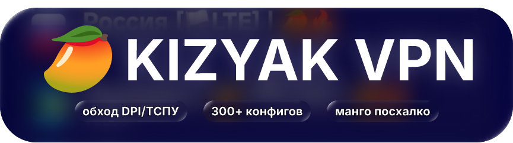

<div align="center">

<!--  -->
<p align="center">
  <a href="https://github.com/Maskkost93/kizyak-vpn-4.0">
    
  </a>
</p>

</div>

# 🥭 КIЗЯК VPN — бесплатные сервера против белых списков в РФ

[](https://github.com/Maskkost93/kizyak-vpn-4.0/commits/main)
[](https://github.com/Maskkost93/kizyak-vpn-4.0/stargazers)


[](https://t.me/+_AQS7X42NBdiNmNi)

 Коллекция публичных и бесплатных конфигураций VLESS / VMess / Shadowsocks / Hysteria2, протестированных для обхода белых списков (БС) и чёрных списков (ЧС) на территории РФ.

⚡*server cfgs are tested and published by katlavan script* 

---

#  ВЕДУТСЯ ТЕХНИЧЕСКИЕ РАБОТЫ РЕПОЗИТОРИЯ. 

Внешний вид README сейчас находися под активным редизайном. Работа генерации конфигураций не нарушена, все основные ссылки на файлы подписки:

<details>
<summary><b>🔗 Сырые githubusercontent ссылки</b></summary>

## ⚠️ ПРЕДУПРЕЖДЕНИЕ

Не рекомендуется использовать такие ссылки если у вас были блокировки GitHub. (Для надежных вариантов см. `Обходные githack ссылки`)


**v8 (формат Happ, INCY и т. д.)**
```
https://raw.githubusercontent.com/Maskkost93/kizyak-vpn-4.0/refs/heads/main/kizyakbeta8.json
```
**v8**
```
https://raw.githubusercontent.com/Maskkost93/kizyak-vpn-4.0/refs/heads/main/kizyakbeta8.txt
```
**v7**
```
https://raw.githubusercontent.com/Maskkost93/kizyak-vpn-4.0/refs/heads/main/kizyakbeta7.txt
```
**v6**
```
https://raw.githubusercontent.com/Maskkost93/kizyak-vpn-4.0/refs/heads/main/kizyakbeta6.txt
```
**v6 (черные списки)**
```
https://raw.githubusercontent.com/Maskkost93/kizyak-vpn-4.0/refs/heads/main/kizyakbeta6BL.txt
```
</details>

<details>
<summary><b>🔗 Обходные githack ссылки (Рекомендуется)</b></summary>

**v8 (формат Happ, INCY и т. д.)**
```
https://raw.githack.com/Maskkost93/kizyak-vpn-4.0/refs/heads/main/kizyakbeta8.json
```
**v8**
```
https://raw.githack.com/Maskkost93/kizyak-vpn-4.0/refs/heads/main/kizyakbeta8.txt
```
**v7**
```
https://raw.githack.com/Maskkost93/kizyak-vpn-4.0/refs/heads/main/kizyakbeta7.txt
```
**v6**
```
https://raw.githack.com/Maskkost93/kizyak-vpn-4.0/refs/heads/main/kizyakbeta6.txt
```
**v6 (черные списки)**
```
https://raw.githack.com/Maskkost93/kizyak-vpn-4.0/refs/heads/main/kizyakbeta6BL.txt
```
</details>

<details>
<summary><b>🔗 Эксперементальные yaproxy ссылки</b></summary>

## ⚠️ ПРЕДУПРЕЖДЕНИЕ

Данные ссылки **не рекомендуются** для повседневного использования. Из-за особенностей работы Яндекс Переводчика, параметры конфигураций могут быть переведены и, следственно, некорректно функционировать и приводить к нерабочим серверам. *Использовать только в рамках отладки.*

**v8 (формат Happ, INCY и т. д.)**
```
https://translated.turbopages.org/proxy_u/de-de.ru.2021335f-6ad4f00b-c0f81118-74722d776562/https/raw.githubusercontent.com/Maskkost93/kizyak-vpn-4.0/refs/heads/main/kizyakbeta8.json
```
**v8**
```
https://translated.turbopages.org/proxy_u/de-de.ru.2021335f-6ad4f00b-c0f81118-74722d776562/https/raw.githubusercontent.com/Maskkost93/kizyak-vpn-4.0/refs/heads/main/kizyakbeta8.txt
```
**v7**
```
https://translated.turbopages.org/proxy_u/de-de.ru.2021335f-6ad4f00b-c0f81118-74722d776562/https/raw.githubusercontent.com/Maskkost93/kizyak-vpn-4.0/refs/heads/main/kizyakbeta7.txt
```
**v6**
```
https://translated.turbopages.org/proxy_u/de-de.ru.2021335f-6ad4f00b-c0f81118-74722d776562/https/raw.githubusercontent.com/Maskkost93/kizyak-vpn-4.0/refs/heads/main/kizyakbeta6.txt
```
**v6 (черные списки)**
```
https://translated.turbopages.org/proxy_u/de-de.ru.2021335f-6ad4f00b-c0f81118-74722d776562/https/raw.githubusercontent.com/Maskkost93/kizyak-vpn-4.0/refs/heads/main/kizyakbeta6BL.txt
```
</details>

---

*katlavan 9.1.6 has been here...*
